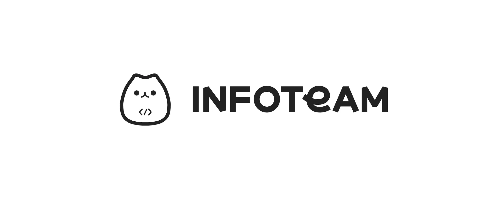

<!-- markdownlint-disable MD041 -->


# Ziggle-backend

## Description

Ziggle의 Backend

## Entity relation diagram

현재, ERD는 다음 링크에서 mermaid로 구현되어 있습니다. [ERD 링크](./docs/erd.md)

## Installation

`@gsainfoteam` 패키지는 GitHub Packages에서 받으므로 `read:packages` 권한이 있는 토큰이 필요합니다.

```bash
$ export NODE_AUTH_TOKEN=$(gh auth token)
$ npm install
```

## Login

인포팀 계정 로그인은 [`@gsainfoteam/account-nest`](https://github.com/gsainfoteam/account-sdk/tree/main/packages/nest)가 맡습니다.
`POST /auth/login`, `/auth/refresh`, `/auth/logout`은 SDK가 만들고, 세션은 Redis에 저장합니다.
IdP 사용자는 `apps/api/src/auth/auth.module.ts`의 `resolve`에서 uuid로 `user`에 upsert 합니다.

`npm run test:e2e`는 가짜 IdP로 로그인부터 guard까지 확인하며, `localhost:6379`의 Redis가 필요합니다.

## Running the app

```bash
# development
$ npm run start

# watch mode
$ npm run start:dev

# production mode
$ npm run start:prod
```

## Chatbot MCP server

Set `MCP_API_KEY` to a secret of at least 32 characters. MCP requests must send
it in the `X-Api-Key` header. If the key is unset, MCP requests return `401`.
Connect an MCP client to `POST /mcp` using the Streamable HTTP transport.

The server exposes two tools:

- `search_notices` accepts a `query` and optional `limit` (1–50, defaults to
  10). It searches existing notice content and returns matching `id`, `title`,
  and `summary` values.
- `get_notice` accepts an `id` and returns the notice's `id` and original
  `body`.

## Admin

Admin 구분 및 권한 변경 API는 [Admin 권한 문서](./docs/admin.md)를 참고하세요.

## Test

```bash
# unit tests
$ npm run test

# e2e tests
$ npm run test:e2e

# test coverage
$ npm run test:cov
```
